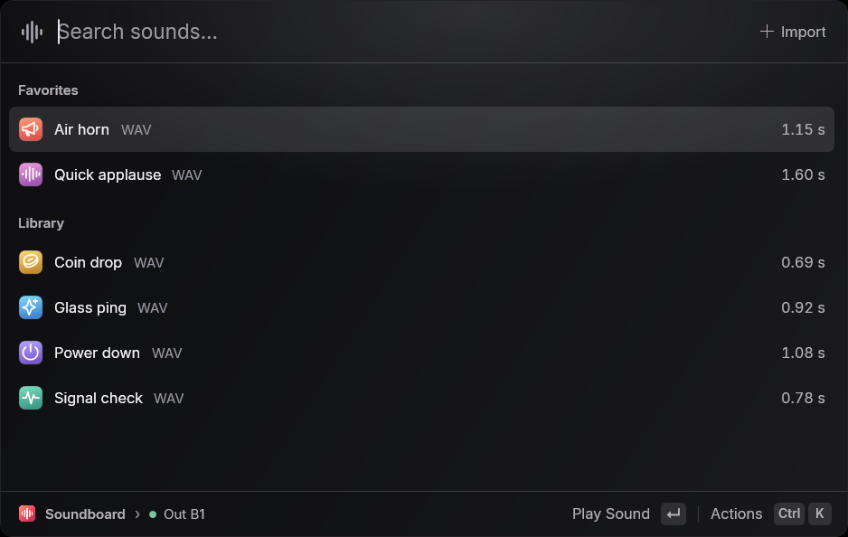

# Soundboard

Drop in a clip, find it by name, and press Enter to play it through your microphone. Soundboard is a small Windows launcher for Voicemeeter Potato. It mixes clips directly into **Out B1**. Your microphone keeps working, and your music, desktop audio and game chat keep their existing strip assignments.

## Get started

1. Start [Voicemeeter Potato](https://vb-audio.com/Voicemeeter/potato.htm) on x64 Windows 10 or 11. In your call or game, select **Voicemeeter Out B1** as the microphone. Older driver versions call it **Voicemeeter Output**.
2. Extract the entire `Soundboard-win-x64.zip` archive and open `Soundboard.exe`. Tagged builds appear under [Releases](https://github.com/SenorLawyer/Soundboard/releases). Each successful pull request build also has a downloadable Windows artifact.
3. Double-click a starter sound, or drop one or more files onto the window. Press **Ctrl+P** to preview the selected clip privately. Click **Out B1** in the footer to choose your A1 or A2 preview device, set the clip volume, or hear a clip locally while sending it.

Keep B1 enabled on the physical mic strip. Any strip you already send to B1 will still reach the call. Push-to-talk and voice filtering in the receiving app also apply to clips.

## Keyboard

| Action | Shortcut |
| --- | --- |
| Show or hide the launcher from any app | Ctrl+Alt+Space |
| Stop playback from any app | Ctrl+Alt+Backspace |
| Find a clip and move through results | Type, then ↑ or ↓ |
| Play or stop the selected clip | Enter |
| Preview on the selected hardware bus | Ctrl+P |
| Open the searchable action panel | Ctrl+K |
| Import files | Ctrl+O |
| Toggle favorite / rename | Ctrl+D / F2 |
| Play a clip from a game | Assign Ctrl+Alt+1 through 9 in Actions |

Esc closes the current panel, stops playback, clears the search, or hides the window, in that order. The tray icon opens the launcher and has a Quit command.

## Files and routing

Soundboard decodes imports on a worker thread with Windows Media Foundation. WAV, MP3, M4A/AAC, FLAC, WMA and the audio track of MP4 files work with the corresponding installed Windows codecs. Additional containers depend on local codec support. Each clip can contain up to five minutes of mono or stereo audio, up to 128 MB decoded. Windows N editions need the Media Feature Pack.

The library and its decoded copies live in `%LOCALAPPDATA%\Soundboard`. You can move the original after import. Search, favorites, shortcuts and playback run locally.

The native output insert adds the clip to the front left and right channels of B1 before Potato's master fader. It takes the insert only during playback and releases it afterward. If another insert effect owns that slot, Soundboard names it in the error message. A1 and A2 always follow the devices assigned inside Potato.

## Development

Run `./scripts/build.ps1` on Windows to build and test, or add `-Package` for a self-contained archive and SHA-256 checksum. The app uses WPF on .NET 10 and a small C++ audio DLL. See the [contributor guide](CONTRIBUTING.md) for prerequisites and hardware checks.

## License

Soundboard and its original starter sounds are [MIT licensed](LICENSE). See [third-party notices](THIRD-PARTY.md) for the font and runtime licenses.
